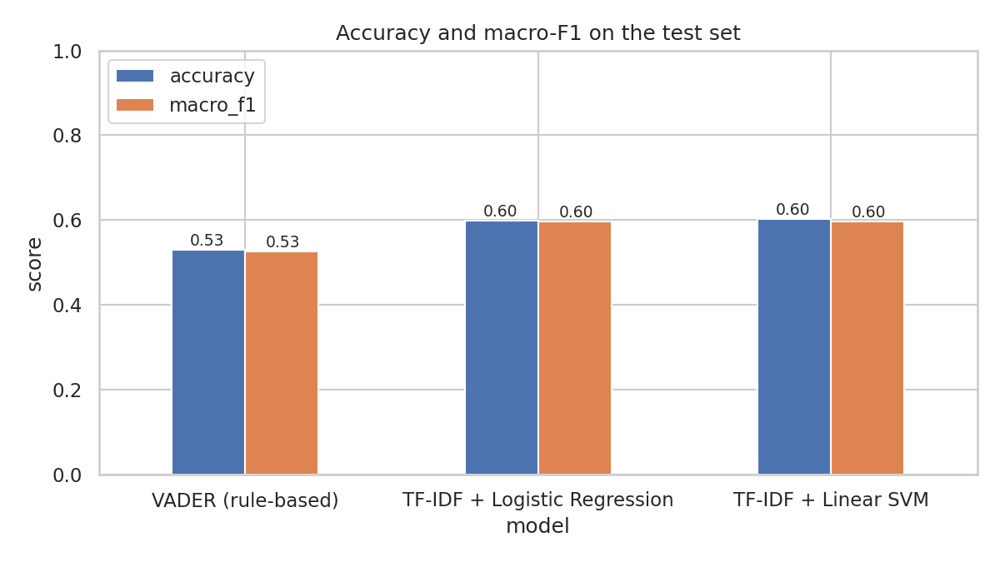
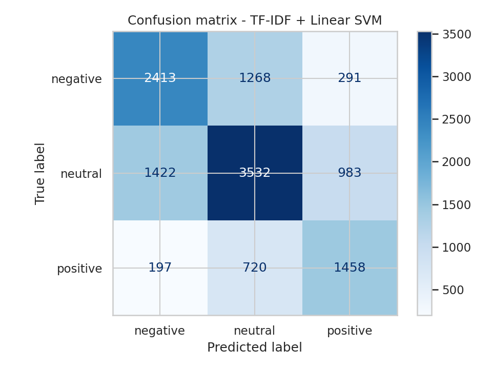
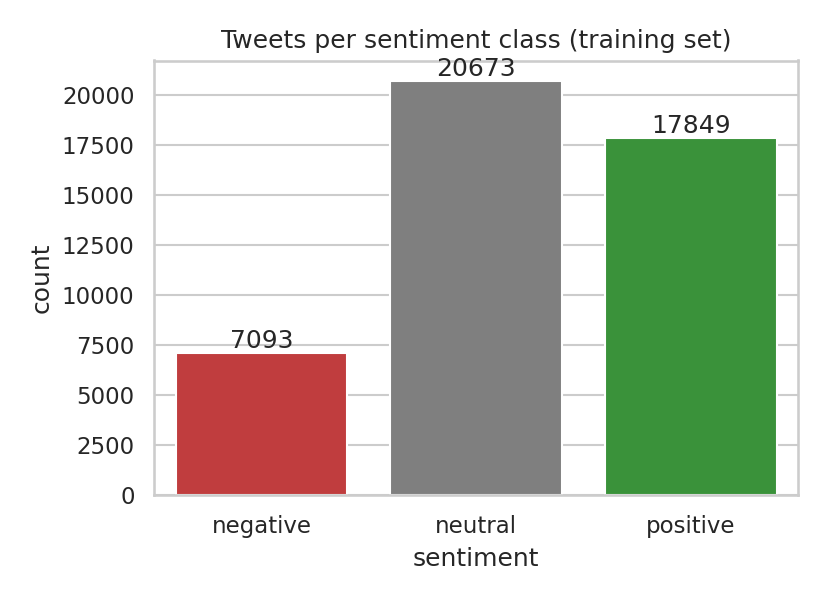
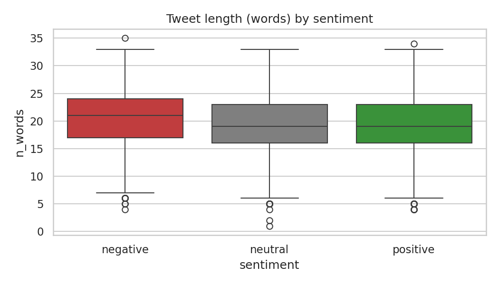
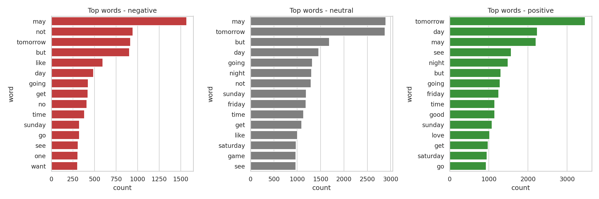
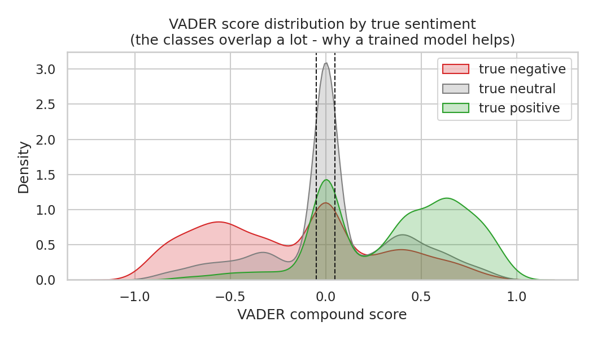

<p align="center">
  
</p>

<p align="center">
  
  
  
  
  
  
</p>

<p align="center">
  A Natural Language Processing tool that classifies tweets as <b>positive</b>, <b>neutral</b> or <b>negative</b>.<br>
  Built with NLTK for text processing; a rule-based lexicon model (VADER) is compared against
  machine-learning models trained on 45 000 real tweets.
</p>

---

## Table of contents

- [Demo](#demo)
- [Results](#results)
- [Data analysis](#data-analysis)
- [How it works](#how-it-works)
- [Quick start](#quick-start)
- [Project structure](#project-structure)
- [What I learned](#what-i-learned)
- [Future improvements](#future-improvements)

---

## Demo

```text
$ python predict.py "This phone camera is incredible, best purchase this year"
POSITIVE (VADER compound +0.64)  <-  This phone camera is incredible, best purchase this year

$ python predict.py "ugh my train is cancelled AGAIN"
NEGATIVE (VADER compound -0.59)  <-  ugh my train is cancelled AGAIN

$ python predict.py "The meeting has been moved to Thursday at 3pm."
NEUTRAL  (VADER compound +0.00)  <-  The meeting has been moved to Thursday at 3pm.
```

Interactive mode (`python predict.py` with no arguments) lets you type tweets one after another.
Each answer shows the trained model's label and VADER's raw score side by side.

---

## Results

Dataset: **TweetEval / SemEval-2017 Task 4A** - 45 615 training tweets and a separate test set of
**12 284 tweets** that the models never see during training.

| Approach | Accuracy | Macro-F1 | Needs training? |
|:--|:--:|:--:|:--:|
| VADER (NLTK rule-based lexicon) | 0.530 | 0.526 | no |
| TF-IDF + Logistic Regression | 0.600 | 0.596 | yes |
| **TF-IDF + Linear SVM** (best) | **0.603** | **0.597** | yes |

<table>
  <tr>
    <td align="center"><b>Model comparison</b></td>
    <td align="center"><b>Confusion matrix (Linear SVM)</b></td>
  </tr>
  <tr>
    <td></td>
    <td></td>
  </tr>
</table>

Why "only" 60 %? Three-way tweet sentiment is a hard task: tweets are short, full of slang,
sarcasm and hashtags, and the *neutral* class is fuzzy even for humans. On this exact benchmark,
classic bag-of-words models score around 0.58-0.63, and large transformer models such as
RoBERTa reach about 0.72. The numbers here are therefore in line with what a TF-IDF approach
is expected to achieve, and the confusion matrix shows the expected pattern: most mistakes are
between *neutral* and one of the polar classes, while positive <-> negative confusions are rare
(only 291 + 197 out of 12 284).

---

## Data analysis

<table>
  <tr>
    <td align="center"><b>Class balance</b></td>
    <td align="center"><b>Tweet length by class</b></td>
  </tr>
  <tr>
    <td></td>
    <td></td>
  </tr>
</table>

<p align="center">
  <br>
  <sub>Most frequent words per class after NLTK cleaning</sub>
</p>

<p align="center">
  <br>
  <sub>How VADER's compound score is distributed for each true class</sub>
</p>

**Key insights**

| Observation | What it tells us |
|:--|:--|
| Classes are imbalanced (45 % neutral, 39 % positive, 16 % negative) | Macro-F1 is reported alongside accuracy, and models are trained with `class_weight="balanced"` |
| Words like *tomorrow, day, may, night* top every class | Frequency alone does not separate sentiment; the model must rely on the *combination* of words, which is why bigrams and character n-grams are used |
| *not, no, but* are among the top negative words | Negation words were deliberately **kept** when removing stopwords |
| VADER's score distributions overlap heavily near zero | A lexicon cannot tell "neutral" from mildly opinionated tweets; a model trained on labelled tweets does better (+7 points) |

---

## How it works

```
tweet -> NLTK cleaning -> TF-IDF features -> classifier -> negative / neutral / positive
         TweetTokenizer   word 1-2 grams      Logistic Regression
         remove @user,    + char 2-5 grams    or Linear SVM
         links, stopwords
         lemmatize
```

In plain words: every tweet is first cleaned with NLTK - user handles and links are removed,
the `#` is stripped from hashtags so the word itself is kept, repeated letters such as
"soooo" are shortened, common filler words are dropped (but negations such as *not* are kept),
and each word is reduced to its dictionary form (lemmatized, e.g. *running* -> *run*).
The cleaned text is turned into numbers with TF-IDF, both at the word level and at the
character level (so misspellings and slang still carry signal). A classifier then learns which
patterns indicate each sentiment. VADER, by contrast, needs no training at all: it looks up each
word in a hand-built dictionary of sentiment scores and combines them with a few grammar rules.

Steps in `sentiment_analysis.py`:

1. **Load** the TweetEval train/test splits (`data/`).
2. **Clean** every tweet with NLTK (`TweetTokenizer`, stopwords, `WordNetLemmatizer`).
3. **Explore** the data - class balance, tweet length, top words, VADER score distributions.
4. **Baseline** - run VADER (`nltk.sentiment.SentimentIntensityAnalyzer`) and map its compound score to three classes.
5. **Train** TF-IDF + Logistic Regression and TF-IDF + Linear SVM.
6. **Evaluate** all three on the held-out test set; save the best model with `joblib`.

---

## Quick start

```bash
git clone https://github.com/ayush-jena-721/twitter-sentiment-analysis.git
cd twitter-sentiment-analysis
pip install -r requirements.txt

python sentiment_analysis.py       # cleans, explores, trains, evaluates (about 3 minutes on CPU)
python predict.py "your tweet here"
```

The NLTK resources (stopwords, VADER lexicon, WordNet) are downloaded automatically on first
run. The dataset is included in the repository, and a pre-trained model is in `outputs/`,
so `predict.py` works straight away.

---

## Project structure

```
twitter-sentiment-analysis/
+-- data/
|   +-- train_text.txt / train_labels.txt   # 45 615 tweets
|   +-- val_text.txt   / val_labels.txt     #  2 000 tweets
|   +-- test_text.txt  / test_labels.txt    # 12 284 tweets
|   +-- mapping.txt                         # 0 = negative, 1 = neutral, 2 = positive
+-- outputs/
|   +-- sentiment_model.joblib              # trained pipeline (TF-IDF + Linear SVM)
|   +-- metrics.txt                         # full classification reports
|   +-- *.png                               # all charts shown in this README
+-- sentiment_analysis.py                   # cleaning -> EDA -> VADER -> training -> evaluation
+-- predict.py                              # CLI / interactive predictor
+-- requirements.txt
+-- README.md
```

---

## What I learned

- How to preprocess noisy social-media text with **NLTK**: tweet-aware tokenisation, stopword
  removal that keeps negations, and lemmatisation.
- The difference between a **lexicon-based** approach (VADER: instant, no data needed, but
  limited) and a **supervised** approach (needs labelled data, but learns the domain).
- Why **character n-grams** help on tweets - they are robust to misspellings, slang and
  elongated words.
- How to evaluate a three-class, imbalanced problem properly with **macro-F1** and a confusion
  matrix, and how to read results against published benchmarks instead of in isolation.
- The limits of bag-of-words: "Not bad, but I expected more" is predicted negative because the
  model sees *not* and *bad* but not their interaction - a motivation for sequence models.

---

## Future improvements

- Fine-tune a **transformer** (e.g. `cardiffnlp/twitter-roberta-base-sentiment`) and compare.
- Add **emoji** handling (emojis are strong sentiment signals in tweets).
- Fetch live tweets for a keyword through the Twitter/X API and plot sentiment over time.
- A small **Streamlit dashboard** for interactive exploration.

---

<p align="center">
  Built with Python | NLTK | scikit-learn | pandas | matplotlib | seaborn  |  Licensed under MIT
</p>
